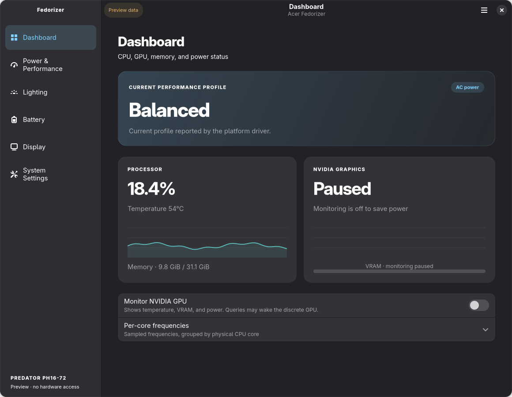
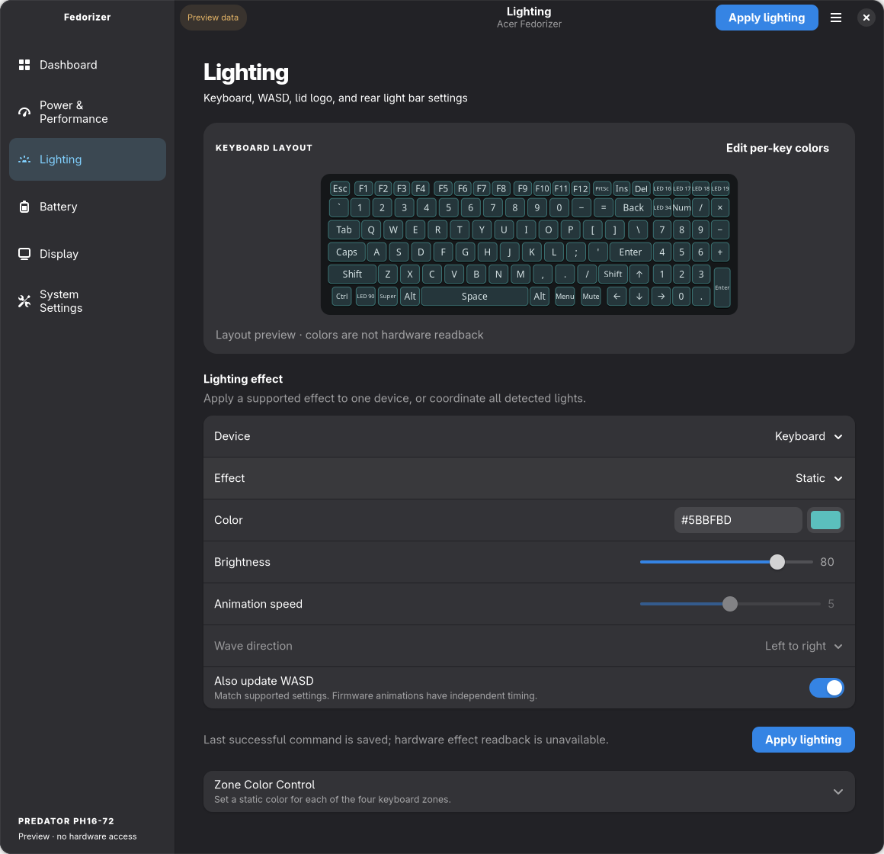

# Acer Fedorizer

A native GTK4/libadwaita control center for the Acer Predator PH16-72 on Linux.
It covers performance, cooling, keyboard and chassis lighting, battery care, and display color in one app.
It uses Python and your distribution's GUI libraries; there is nothing to compile for the app itself.

## Install

From the downloaded folder, as your desktop user:

```sh
./setup.sh install
```

Setup installs the dependencies, the hardware service, a desktop launcher, and the rear lightbar driver.
It asks for sudo only for system changes; the app itself runs without administrator rights.
Open **Acer Fedorizer** from your app menu or run `acer-fedorizer`.

| Command | Action |
| --- | --- |
| `./setup.sh install` | Install, or fully replace an existing installation. |
| `./setup.sh uninstall` | Remove app files, settings, backups, and the lightbar driver. |
| `./setup.sh status` | Check the service, socket, files, and driver without changing anything. |
| `./setup.sh help` | Explain these commands. |

If any installation exists, including one under an older name, setup asks `This will completely overwrite your installation. Proceed? [y/n]`.
Only `y` continues.
If the new installation fails, setup restores the previous one; if even that fails, it tells you where the backup is kept.
Saved lighting is reset only after a successful reinstall.
Uninstall keeps shared OS packages and the downloaded folder.

Supported: Fedora, Ubuntu 24.04, and Debian 13 on x86_64 with systemd, GTK 4.10+, and libadwaita 1.4+.
Debian 12's libraries are too old.
Hardware support is PH16-72 only; see [Compatibility.md](Compatibility.md).
With Secure Boot you may need to enroll your distribution's DKMS signing key before the lightbar driver loads.

## Screens

- **Dashboard:** CPU use and temperature, memory, per-core frequency, and optional NVIDIA temperature, VRAM, and power. GPU monitoring starts off because it may wake the discrete GPU. Sampling pauses while the window is minimized and stops when it closes.
- **Power & Performance:** stock driver profiles and fan modes, fan RPM, and an Apply button. If a fan write fails or the service stops for any reason, fans return to automatic.
- **Lighting:** one editor for Keyboard, WASD, Logo, and Bar, with a separate unsaved draft per device. Pick a firmware effect, color (picker, hex, or swatches), speed, brightness, and direction; options a device does not support are disabled. WASD can follow the keyboard, all lights can be set together, and the keyboard offers four zones or a per-key editor drawn from its real LED layout. Apply sends the selected device and reports what was sent.
- **Battery:** charge, time estimates when available, health and cycles, and only the charge controls your driver exposes.
- **Display:** Native SDR color management on a supported built-in Mutter panel; keeps your monitor setup and is off while HDR is on.
- **System Settings:** installation checks without sudo, device capabilities, connection details, and licenses and credits.

The hardware service keeps running after the window closes, waiting for commands and the Predator button.
It does no dashboard or GPU monitoring, and closing the window does not reset any setting.
Lighting shown in the app is the last successful command, not a reading from the device.
The service reapplies it at start, after sleep, and when a lighting device reconnects.

## Screenshots and preview

Screenshots are real app renders with labelled sample data, not live measurements.




[Power & Performance](docs/screenshots/performance.png) · [Battery](docs/screenshots/battery.png) ·
[Display](docs/screenshots/display.png) · [System Settings](docs/screenshots/diagnostics.png) ·
[Per-key editor](docs/screenshots/keyboard.png) · [Credits](docs/screenshots/credits.png)

```sh
./run.sh --preview
./run.sh --screenshots docs/screenshots
```

Preview never connects to the hardware service or the desktop display API.
With dependencies installed, `./run.sh` starts the real app from source without installing it.

## Development and licensing

See [CONTRIBUTING.md](CONTRIBUTING.md), [AGENTS.md](AGENTS.md), and [NATIVE-CONTROLS.md](NATIVE-CONTROLS.md).
`scripts/package.sh` builds one source-complete archive and a checksum.

The app and daemon are GPLv3; the separate kernel module is GPLv2.
[NOTICE.md](NOTICE.md) lists attribution, protocol sources, and runtime dependencies.
Full terms are in [LICENSE](LICENSE) and [LICENSES](LICENSES).
